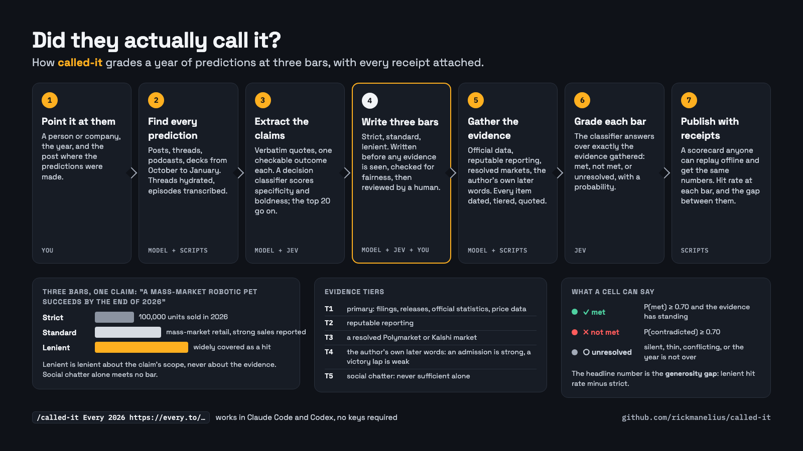

# Called It!

**Using AI Classifiers to Score a Person's Annual Predictions**

**Did they actually call it?** Grade any person's or company's annual predictions at three bars,
strict, standard and lenient, against the year's public evidence, with every receipt committed so
anyone can replay the scorecard.

```
/called-it Every 2026 https://every.to/context-window/every-s-2026-predictions
```

Every argument about whether a prediction "came true" is an argument about the bar. `called-it`
grades at three bars at once and shows all three, so the argument is visible instead of hidden
inside one grader's generosity. The gap between the lenient and strict hit rates is the number it
exists to measure.



Where to look: the [gallery site](https://rickmanelius.github.io/called-it/) has every graded
subject with its scorecard, bars, data and a share button, and the
[article](https://www.rickmanelius.com/p/called-it) tells the story, with the 90-second explainer
embedded. Both links are placeholders until the post is live.

## What it does

1. **Discovers** every place the subject published predictions for the target year (default window:
   Oct 1 of the prior year to Jan 31), including X threads hydrated through the API and podcast
   episodes through their captions.
2. **Extracts** discrete claims with verbatim quotes, then scores each one for whether it is a
   prediction at all, how specific it is, whether it is binary or a matter of degree, and how bold it
   was when made. The top 20 are selected.
3. **Operationalizes** each claim into three bars before any evidence is gathered. Each bar has a
   plain `criterion` (what counts, in the author's own terms) and a `measure` (how we look: the
   series, the source, the provisional rule). A decision classifier is asked whether a skeptical
   critic would accept each bar as fair and whether it is checkable; the flags go on a review sheet
   (`rubrics.md`) that a human reads before any evidence is fetched.
4. **Gathers** the year's evidence per claim: official sources, reputable reporting, resolved
   Polymarket and Kalshi markets, the author's own later statements, and anything the user attaches.
   Every item carries a tier, a date, a URL and a quote.
5. **Grades** each (claim, bar) with [TypeSafe's Jev](https://docs.typesafe.ai), a System One model
   that returns calibrated probabilities rather than prose, over exactly the evidence rows gathered.
   Without a key, the hosting model answers the same typed questions.
6. **Reports** a scorecard: hit rate at each bar, the generosity gap, a per-claim ladder, and the
   evidence behind every cell. `report.md` carries YAML frontmatter with the grader model and the
   SHA-256 of every input file; `report.html` is the shareable page; `data.json` and `export/*.csv`
   feed charts and spreadsheets. Claims whose horizon is after the run date are marked provisional.

A run folder (`runs/<subject>/`) is the unit of publication. It holds the exact text graded, the
exact questions asked, the exact evidence shown to the grader and the grader's exact answers.
`called-it replay <run>` re-renders the scorecard with no key and no network. `called-it archive <run> <source>`
fetches the Wayback Machine snapshot nearest the source's publication date and compares it with the
live page, so a list edited after the fact is graded as it was published.

## Install

**Claude Code**

```
/plugin marketplace add rickmanelius/called-it
/plugin install called-it@called-it
```

**Codex, Cursor, Gemini CLI and other Agent Skills hosts**

```
npx skills add rickmanelius/called-it -g -y
```

Requires Python 3.12+. No packages to install; the scripts use the standard library only.

Optional upgrades, detected at run time and named in every scorecard's footer:

| Env var or tool | What it adds |
|---|---|
| `TYPESAFE_API_KEY` | Jev grading: calibrated, repeatable probabilities (the same question asked twice returns the same answer within a few points) |
| `X_BEARER_TOKEN` | X thread hydration and in-window account search (pay-per-use; the script estimates before reading and logs every post) |
| `yt-dlp` | podcast and video captions as sources |
| a browser (Claude in Chrome, Playwright, or you logging in) | paywalled sources; the skill names the exact URL it could not read and asks |
| `last30days` skill | a deep per-claim evidence sweep |

## The three bars

| Bar | Question it answers |
|---|---|
| **strict** | What would a hostile critic require before conceding? Usually the literal claim with its numbers and dates intact. |
| **standard** | What would a fair reader accept as "this happened"? |
| **lenient** | What is the weakest reading a critic would still concede counts? Lenient about the claim's scope, never about the evidence. |

Social chatter is never sufficient evidence at any bar. An author claiming their own hit is weak
evidence; an author admitting a miss is strong evidence.

## Direct CLI use (scripting, CI, replays)

```bash
python3 skills/called-it/scripts/called_it.py init every --subject Every --kind company --year 2026 \
    --canonical https://every.to/context-window/every-s-2026-predictions
python3 skills/called-it/scripts/called_it.py fetch every          # every source into the cache
python3 skills/called-it/scripts/called_it.py classify every       # score, rank, select the top 20
python3 skills/called-it/scripts/called_it.py check-rubrics every  # is each bar fair and checkable?
python3 skills/called-it/scripts/called_it.py sheet every          # rubrics.md for the human review
python3 skills/called-it/scripts/called_it.py grade every          # grade every (claim, bar) on the evidence
python3 skills/called-it/scripts/called_it.py report every         # report.md, report.html, data.json, export/*.csv
python3 skills/called-it/scripts/called_it.py post every           # draft of the self-review thread the subject could publish
python3 skills/called-it/scripts/called_it.py share every          # share.json + share.md: the quote-post text, the original post to quote, the card, the page link
python3 skills/called-it/scripts/called_it.py replay every         # offline, from the committed cache
python3 skills/called-it/scripts/called_it.py drift every --n 20   # re-ask cached questions live and measure the drift
python3 skills/called-it/scripts/called_it.py status every
```

The slash command is the product; the CLI is how the committed runs are reproduced.

## Runs in this repo

| Run | Subject | Space | Status |
|---|---|---|---|
| `runs/every` | Every (every.to) | AI | graded 2026-10-24: 4% strict, 32% standard, 55% lenient, gap 50 points, 16 of 22 open |
| `runs/ippolito` | Mike Ippolito, Blockworks | crypto | graded 2026-10-24: 10% strict, 35% standard, 45% lenient, gap 35 points, 7 of 20 open |
| `runs/doll` | Bob Doll, Crossmark Global | finance | graded 2026-10-24: 21% strict, 29% standard, 36% lenient, gap 14 points, 5 of 14 open |
| `runs/galloway` | Scott Galloway, Prof G Media | business | graded 2026-10-24: 0% strict, 27% standard, 47% lenient, gap 47 points, 8 of 15 open |

"Open" means unresolved at the strict bar as of the run date: the year is not over, the data is
quarterly, or nobody publishes the number the prediction implied. Every run is provisional until
December 31 (the midterm claims until November 3).

## Tests

```bash
python3 -m unittest discover -s tests
```

## What is committed, and why

Each run folder keeps the extracted text of every source it read (`runs/<run>/cache/pages/`, text
only, never raw HTML) so `replay` works offline and anyone can see exactly what the grader saw. The
font files under `site/assets/fonts/` (Space Grotesk, IBM Plex Mono) are from Google Fonts and are
licensed under the SIL Open Font License 1.1.

## License

MIT.
