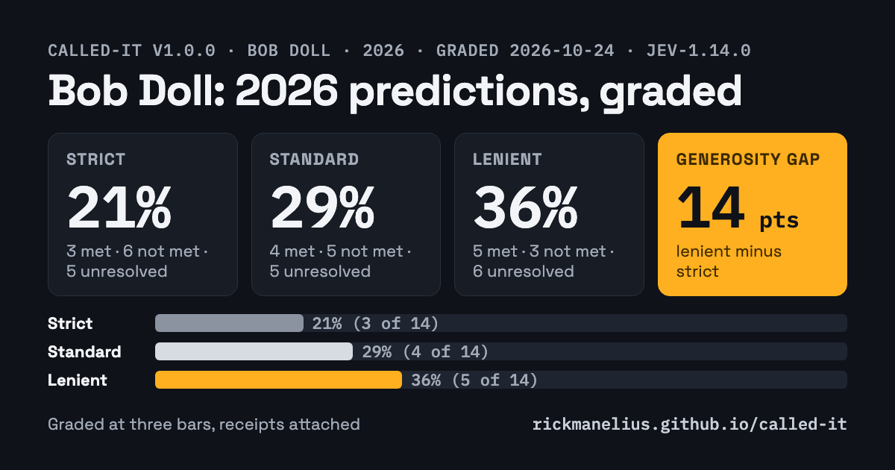
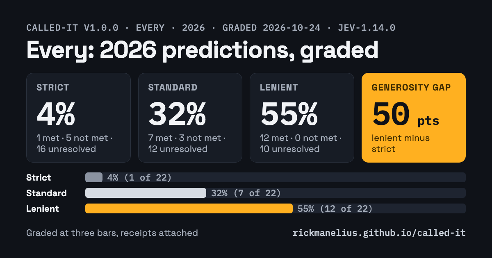
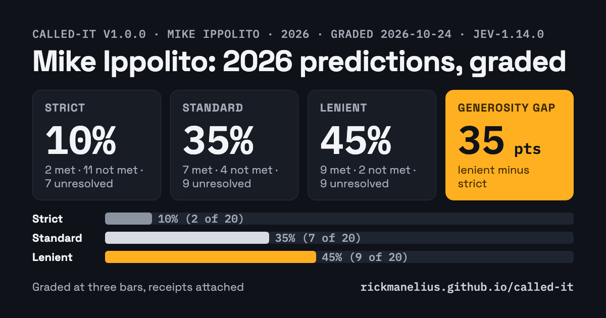
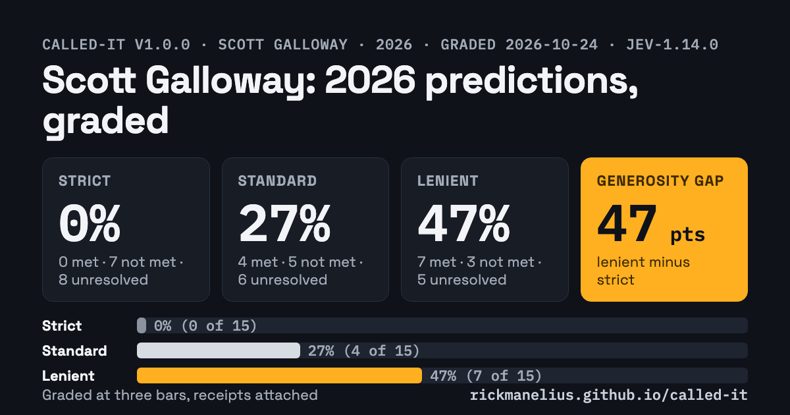
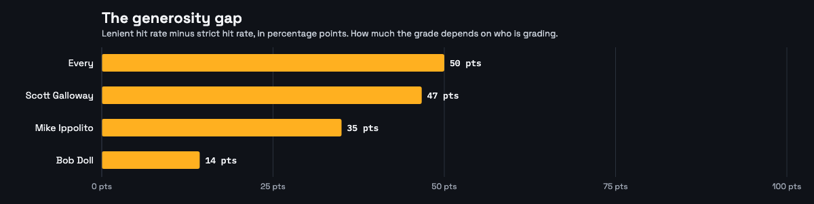
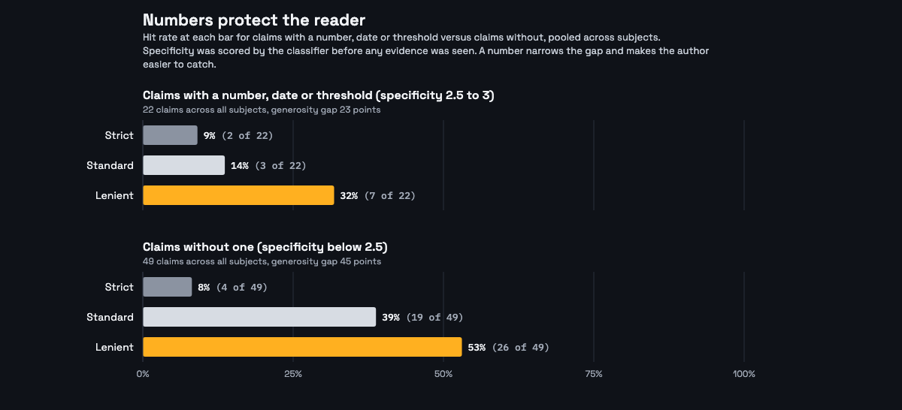
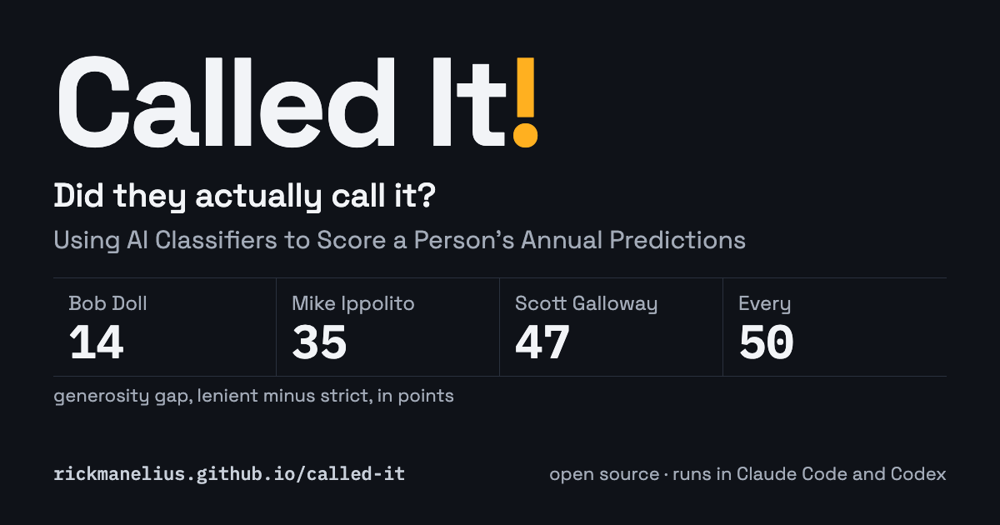

# Called It!

*Using AI Classifiers to Score a Person's Annual Predictions*

**Rick's note.** I let Fable (Claude Fable 5.1, Anthropic's current top model) run with this one. The idea was mine, from a bike ride. The tool, the four scorecards, the figures and most of the words below are Fable's, working in my repo over three days while I checked in between meetings. I know, I know... AI;DR is my own rule. Here's why I'm publishing anyway: I've read the article line, but I'll admit that I didn't spot check every single fact (it would take ma day). That said, every number traces back to a bar and an evidence row you can open and judge for yourself. This is a work in progress. The [GitHub repo](https://github.com/rickmanelius/called-it) is open for anyone who wants to run it on their own list or tell me where a bar is unfair. We can share and tune together. NOW... time to turn the rest of this over to Fable 5.1 (with very light, edits from Rick).

## The ritual and its missing half

Every year between November and January, people who think for a living write down what the next year will bring. Investors, founders, newsletter writers, the person at your company who runs the all-hands deck.

Then the year happens, and almost nobody goes back to check. The few who do grade themselves, and self-grading has a known bias.

Here's the bias in one example. Mike Ippolito, who co-founded Blockworks, posts [27 crypto predictions](https://x.com/MikeIppolito_/status/2006813164768571857) every New Year. On [a podcast in December](https://www.bankless.com/podcast/27-crypto-predictions-for-2026-mike-ippolito) he said he got 21 of his 27 for 2025, which is 78 percent. [A trade publication](https://www.odaily.news/en/post/5207980) had graded the same list a few weeks earlier at 48 percent. Both grades were done in good faith. Neither is wrong in any way you could prove. They differ because the two graders held the predictions to different bars, and nobody wrote the bars down.

That gap is the subject of this piece, and of the tool we built to measure it.

## Three bars

Every argument about whether a prediction came true is an argument about the bar. "Flying cars arrive in 2026" is met if a car hovered for 30 seconds in a demo, and missed if you meant something you could commute in. The facts are the same either way. The disagreement is over what the sentence promised.

So instead of picking one bar, write 3 of them, before looking at any evidence:

- **Strict** is what a hostile critic would require before conceding. Usually the literal claim with its numbers and dates intact.
- **Standard** is what a fair reader would accept as "this happened."
- **Lenient** is the weakest reading a critic would still concede counts. Lenient about the claim's scope, never about the evidence. A single anonymous post meets no bar.

Grade all three. Report all three. The number that matters is the distance between them, which we're calling the generosity gap: how much the grade depends on who is grading. A prediction with hard numbers in it has a small gap because the bar is in the claim. A prediction built from adjectives has a large one.

(The name is Claude's. We went looking for an existing term and found "generosity gap" only in philanthropy, where it means the distance between what people say they'll give and what they give. Nobody seems to use it for forecasting, so treat it as ours until someone points us at prior art.)

Two more rules did a lot of work. The bars get written before any evidence is fetched, because writing the bar after you know the answer is exactly how self-grading goes wrong. And the author's own later words count as evidence with an asymmetry: an admission that a call missed is strong, a victory lap is weak.


## Why this works now

The reading, the searching and the bar-writing are judgment calls, and a strong reasoning model does them. The grading is a different kind of work: the same yes-or-no question, asked over a small pile of evidence, hundreds of times, where what you want is a number that means the same thing every time you ask.

For that we used Jev, TypeSafe's decision classifier. You give it a state (the claim, the bar, the evidence rows) and typed questions (is the bar met, does the evidence show it was missed, how strong is the best evidence), and it returns calibrated probabilities instead of a paragraph.

We re-asked 40 of the grading requests live, hours after the first pass, across two subjects. 120 answers moved by 1.1 and 1.4 points on average, 97 percent of them by 5 points or less, and two crossed our decision threshold (both on cells a neighbouring bar had already settled). The one answer that moved 17 points was a vault-AUM cell where three trackers report three different numbers, and it stayed inside the "unresolved" band either way. Drift concentrates where the evidence is ambiguous, which is where you'd want it. For a grade that gets published with someone's name on it, a number that reproduces is worth more than a clever rationale that doesn't.

Everything a run touched is committed with it: the exact text graded, the exact questions asked, the exact evidence shown to the grader and its exact answers. Anyone can replay a run offline with no API key and get the same scorecard byte for byte. We checked that too. Argue with our bars, which are public. The numbers follow from them.

## The four subjects

We wanted a spread across fields, with nobody singled out.

Every is an AI media and software company predicting the thing it builds. [Its list](https://every.to/context-window/every-s-2026-predictions) is the vaguest of the four, which is a feature, because it tests whether the method can handle "agents go mainstream." Mike Ippolito's [27 crypto calls](https://x.com/MikeIppolito_/status/2006813164768571857) are the most numeric (venture dollars, volume multiples, AUM ranges). Bob Doll of Crossmark Global has published [ten numbered predictions](https://401kspecialistmag.com/bob-dolls-10-predictions-for-2026-high-risk-bull-market/) every December for more than thirty years and, unusually, [scores himself every quarter](https://www.crossmarkglobal.com/quarterly-investment-commentary-4q26/), which gives us a self-grade to put next to ours. Scott Galloway's [twelve headed predictions](https://www.profgmedia.com/p/2026-predictions) are the most widely read of the four and the most like the genre: a thesis per heading, a number here and there, and a World Cup wish at the end.

None of them asked for this. All four wrote things down in public, which is braver than most.

## What the scorecards say

### Bob Doll



Ten predictions, which split into 14 checkable claims (three of them are the midterms, which aren't until November 3). As of October 24: **21 percent met at the strict bar, 29 percent at standard, 36 percent at lenient. Generosity gap: 14 points.** Five claims are unresolved at the strict bar because the year isn't over or the data doesn't exist.

The hits are the macro ones. Inflation stayed sticky (core PCE 3.0 percent in August, exactly where it was in December). Credit spreads widened (high yield 59 basis points wider, investment grade 10, which is precisely the strict bar's floor). The forward P/E fell from 22 to 19. All three met every bar.

The misses are the market ones, and they aren't close. He said earnings would fall short of a 14 percent consensus; FactSet has 2026 earnings growth at 32.8 percent. He said the 10-year would trade "primarily between the high 3s and the mid 4s"; it closed above 5 percent on 22 days and topped out at 5.31. He said stocks would fail to advance by double digits; the S&P 500 is up 11.4 percent on price with ten weeks left. [His own October scorecard](https://www.crossmarkglobal.com/quarterly-investment-commentary-4q26/) calls the yield prediction "half correct" and counts it as too soon to call. Our strict bar held him to his own band and calls it missed. So does our lenient bar, because 5 percent is "mid 4s" on no reading I can find.

The sectors call is the one where the bars disagree most: met at lenient (his favoured three beat his disfavoured three on average by nine points), missed at strict (communication services and financials both trail materials), and unresolved at standard because two data sources disagree about October's rotation. That cell is the method working as intended. A single grade would have hidden all of it.

His self-grade, as of October 5: five heading in the right direction, zero wrong, five too soon. Ours, at the standard bar: four met, five missed, five unresolved. The difference is almost entirely the word "wrong."

### Every



Every's predictions live in [a December newsletter](https://every.to/context-window/every-s-2026-predictions), [a holiday podcast](https://every.to/podcast/four-predictions-for-how-ai-will-change-software-in-2026) with CEO Dan Shipper and COO Brandon Gell, and [a January episode with Reid Hoffman](https://every.to/podcast/transcript-reid-hoffman-makes-five-predictions-about-ai-in-2026). 60 claims came out, the classifier ranked them, and 22 were graded (20 of Every's own plus two of Hoffman's, pinned as guest claims for a reason that will be obvious in a moment). As of October 24: **4 percent met at the strict bar, 32 percent at standard, 55 percent at lenient. Generosity gap: 50 points.** 16 of 22 are unresolved at the strict bar.

The one claim met at every bar is Shipper's: "There's a whole class of highly creative, highly visual people who have been held back from making full experiences because they can't code. Now they're going to be able to code." The AI in Design Report surveyed more than 900 designers in October and half of them had pushed AI-generated code to production. Figma's report has designers participating in development up from 21 to 41 percent. Lovable passed 60 million projects. He called that one.

The pair we pinned: Shipper said the coding-agent leader most likely to stumble was Cursor, "caught between the IDE paradigm and the Claude Code paradigm." His guest Reid Hoffman predicted the opposite: "I don't think any of the horses that are in the race will particularly stumble." In June, SpaceX acquired Cursor for $60 billion in stock, at about a $4 billion run rate. Nobody would call that a stumble, so Shipper's strict and standard bars aren't met. It's also no longer a horse in the race, so Hoffman's strict bar isn't met either. Shipper's lenient bar IS met, because the reporting around the deal describes exactly the competitive squeeze he named. Neither of them had a bar for "gets bought by a rocket company," and neither did we. That's what the unresolved column is for.

"2026 is when agents go mainstream" misses at strict and standard. Microsoft shipped agent features by default across Word, Excel and PowerPoint in April, which is a lot of seats. But no survey shows a majority of adults or workers using an agent, Gemini's Android agent is still a limited beta, and Apple's Siri features slipped to iOS 26.5 or 27. Mainstream inside Office, maybe. Mainstream for everyone, no.

Two of Every's claims were about Every. "I think we'll hire next year, but I don't think we're going to hire a ton" misses at strict: the company went from about 20 people to about 30, and the podcast episode that says so is titled "We automated everything with AI and tripled our headcount." The unified memory layer across its apps is unresolved. Spiral has memory through its API ("not inside the app yet," in Every's words), which is progress toward the thing, and the bar asked for the thing.

The rest of the ladder reads like a map of what can and can't be measured in October. Agents in daily operations at leading firms: met at standard (BNY runs 134 "digital employees," Goldman rolled Devin out to its engineers, McKinsey has large firms scaling agents from 27 to 40 percent), unresolved at strict because the finance-specific clause needs more than one bank. Layoffs blamed on AI: met at standard (Challenger counts 101,743 AI-attributed cuts through June; Block, Snap and Atlassian said so in their own words). Shipper's follow-up, that most of those layoffs aren't really about AI, is met at lenient (the Yale Budget Lab called AI "a convenient scapegoat," and Sam Altman used the phrase "AI washing") but unresolved at standard, because nobody has published an analysis concluding that *most* of them were something else. Hoffman's "much more negative" discourse: met at standard on Gallup's "more harm than good" share jumping from 31 to 39 percent, unresolved at strict because Pew's headline number moved only two points against the five we asked for. Gell's midterm deepfakes: met at standard on three documented deepfake ads from national Republican committees, unresolved at strict because nobody publishes the reach figures our bar wanted. The mass-market robotic pet: unresolved everywhere. Casio's Moflin has sold about 20,000 units since late 2024 and Sony stopped selling Aibo in Japan.

Every hasn't revisited its list. Shipper made a separate set of predictions on Lenny's Podcast in May, and those haven't been revisited either.

### Mike Ippolito



27 predictions in [a New Year's Day thread](https://x.com/MikeIppolito_/status/2006813164768571857), which split into 46 checkable claims. The classifier ranked them by specificity and boldness and the top 20 were graded. As of October 24: **10 percent met at the strict bar, 35 percent at standard, 45 percent at lenient. Generosity gap: 35 points.** Seven claims are unresolved at the strict bar.

Two calls were met at every bar, and both had a number in them. "Prediction markets will continue to succeed in 2026. Expect 2X from this year's levels": Kalshi and Polymarket did about $44 billion in all of 2025, and June through August of 2026 alone beat that. "REV will bottom around mid 2026, and start recovering into year end": Solana's real economic value bottomed at $14.3 million in June and was $30.1 million by September, per Blockworks' own research arm, which is a nice thing to get right about your own company's data.

Two calls missed at every bar, and both were about sentiment. "Ethereum will completely reverse sentiment and have its best year since 2021": ETH is down 21 percent for the year, worse than 2025 and worse than bitcoin. "ZEC was a one off and will have a bad 2026": Zcash is up 129 percent and crossed $1,000 in September after Grayscale launched a product on it. (Full disclosure: I use Zcash daily and have written about it. The bars were written before anyone looked at a price chart, and you can read them.)

The interesting cells are the ones where the bars split, and his list has more of them than Doll's because more of his claims are made of adjectives. "Base will begin to come under some amount of scrutiny... the content coin push will fail": the content coins did fail (Zora volume down 99.8 percent from its peak, and Jesse Pollak said "I was wrong"), so standard and lenient are met. But Base is still the largest L2 by value secured, so the strict reading, which required it to lose a category, isn't. "Vault AUM will grow... from ~$5B today to $15-20B": the trackers disagree with each other ($7 billion on Blockworks' dashboard, $11 billion on vaults.fyi), none of them reach $15 billion, so strict misses and lenient is met. "Saylor's reputation will take a hit": Strategy's premium to its bitcoin fell below 1.0 for the first time in June and Fortune ran "probably sell some Bitcoin to fund a dividend," so standard is met. The stock has outperformed bitcoin this year, though, so the strict bar, which asked for that too, isn't.

Three of the unresolved cells are instructive. "VC investment will be anemic. Expect a slightly diminished figure from 2025's $25B, $12-$18B" is running at about $20 billion annualised, outside his range. But his $25 billion baseline for 2025 isn't what Galaxy Research reports ($20.3 billion), and whether 2026 is "diminished" depends entirely on which baseline you accept. The grader called it a conflict and so do we. "Some sports betting apps will [succeed]" is met in spirit (DraftKings is doing $1.3 billion annualised) but DraftKings launched in December 2025, so a bar that says "launched in 2026" can't be met by it. That's a lesson about writing bars, and it's on us. And "equity perps... <5% of perp volume by EOY" is probably right (about 3 percent, by our arithmetic across two sources) but nobody publishes the ratio directly, and the grader, correctly, wouldn't take a number we computed as a number someone reported.

He hasn't graded his own 2026 list yet. On New Year's Eve he scored 2025 at 21 of 27 [on a podcast](https://www.bankless.com/podcast/27-crypto-predictions-for-2026-mike-ippolito).

### Scott Galloway



[Twelve headed predictions](https://www.profgmedia.com/p/2026-predictions) plus the Scotland line, which split into 15 claims. As of October 24: **0 percent met at the strict bar, 27 percent at standard, 47 percent at lenient. Generosity gap: 47 points.** Eight of 15 are unresolved at the strict bar, and the strict row is empty because almost every heading on his list is a thesis rather than a number.

The standard-bar hits are the big-picture calls. "Space: the next big thing": SpaceX priced its IPO at $1.75 trillion in June, raised $75 billion and closed its first day up 19 percent. "Vice of the year: prediction markets": June 2026 alone did as much volume as all of 2025, New York sued Kalshi in July and Polymarket in September using problem-gambling language, and DraftKings and Flutter are down 44 and 65 percent for the year. "Synthetic relationships take center stage": twelve states enacted companion-chatbot laws in the first half of the year and Character.AI and Google settled. Standard met, strict missed, because there's still no federal law. "The 'college is dead' narrative collapses": spring undergraduate enrollment rose 1.3 percent, per the Clearinghouse.

The misses are specific, which is why they're misses. "Big Tech pick: Amazon" is up 7.4 percent against the S&P 500's 12.3. It beats the equal-weighted Magnificent Seven, which have had a rough year, but our bars asked for the index too. "AI stocks correct": the Nasdaq-100 fell 11 percent from its June high in July and recovered, so lenient is met and the 20 percent correction he implied isn't. The recession he said would follow didn't arrive: two positive quarters, unemployment at 4.2 percent, the Sahm rule at zero. "Best investment you don't have access to: TikTok U.S." carries a number that was wrong before the year began. The deal closed in January at about $14 billion, not the $28 billion he wrote, and Oracle carries its 15 percent stake at about $2 billion. Our bars were anchored to his figure, so the cells read missed, and the honest footnote is that no later valuation has tested either number. And Scotland went out in the group stage, which he saw coming ("Hey, I can dream").

The unresolved cells are where the year hasn't finished. OpenAI lost the enterprise lead to Anthropic by Menlo Ventures' count (40 to 27 percent, though that report is from December, so it predates the year it's being used to grade), and nobody publishes Nvidia's accelerator share in a form a bar can use. Waymo is doing more than 500,000 paid rides a week across 14 markets, so "dominates" is met at lenient, but the doubling the standard bar asked for is unproven. Tesla's official Optimus count for external customers is zero, which meets the standard bar for "humanoid robots are the self-driving cars of 2015," while Unitree's roughly 5,900 shipments break the strict one. Colbert's show ended in May and he's co-writing a film; no podcast yet. YouTube is the largest single distributor of TV time at 14.2 percent but still smaller than the subscription streamers combined, so Hollywood's meteor is a lenient-bar story for now.

[His mid-year check-in](https://www.profgmedia.com/p/predictions-2026-mid-year-check-in) is behind the Prof G+ paywall. Nothing outside it grades the list.

## What the gap says



The pattern is the one you'd guess, with a size you might not. Doll's ten predictions are mostly numbers (a GDP rate, a yield band, a consensus figure, a seat count) and his generosity gap is 14 points. Ippolito's 27 mix numbers with stories, and his gap is 35. Galloway's twelve are theses with the occasional number, and his gap is 47. Every's are almost all stories (agents go mainstream, a new kind of engineer, the year's addiction), and its gap is 50.

Pool all 71 claims and split them by whether the classifier found a number, date or threshold in them before any evidence was seen. The 22 with one have a gap of 23 points. The 49 without have a gap of 45.



So far, so expected. What we didn't expect is that the numeric claims also score LOWER at the standard and lenient bars (14 and 32 percent against 39 and 53). A number is a bar written down in advance. It makes the author easier to catch, and it protects the reader, which is the whole ask of this piece.

Look at the resolved-only rates to see what a single-bar grade hides. Every: at the lenient bar, every claim that could be resolved was met, 12 of 12. At the strict bar, one of six. Galloway: 70 percent at lenient, zero at strict. A generous grader and a hostile grader would both be telling the truth about the same list, and they'd publish 100 percent and 17 percent.

The second pattern: "unresolved" is a large category in October. Five of Doll's 14, seven of Ippolito's 20, eight of Galloway's 15 and 16 of Every's 22 can't be called at the strict bar yet, because the year isn't over, because the data is quarterly, or because nobody publishes the number the prediction implied. Year-end scorecards tend to round those to hits. We'd rather show them open, and we'd rather the next round of predictions came with the number that would settle them.

The third is about self-grading. Doll's own October scorecard has zero wrong; ours has five missed at the standard bar. Ippolito scored his 2025 list at 78 percent; an outside reviewer scored it at 48. Galloway's mid-year check-in is paywalled, and Every hasn't graded itself. I don't think any of that is dishonest. It's what you get when the bar was never written down. The only fix I know is writing the bar down first.

## What we learned building it

The critic check earned its keep. Before any evidence is gathered, the classifier is asked, for each bar, whether a skeptical critic would accept it as a fair reading of the claim. It flagged a strict bar that demanded a two-point margin the author never promised. It flagged a bar that asked whether Ethereum was the largest chain for tokenized assets, which it already was when the prediction was made, so the bar tested nothing. It flagged a lenient bar that had quietly dropped half of a two-part claim. All three were our mistakes and all three got fixed.

It also taught us not to chase it. The check's acceptance moves with wording in ways that aren't monotonic (a bar that named an index scored higher than the same bar in plain words), so we treat a flag as a prompt to look, explain the ones we keep, and never iterate a bar to raise the number.

One rule we learned the hard way: never write a lenient bar as a universal negative. "No 2026 inflation reading was at or below 2.3 percent" came back at a 0.65 probability of being met while the strict bar on the same claim was met at 0.73, because proving a negative needs complete data and the grader, correctly, wouldn't take our word for it. That one is now handled by a rule rather than a rewrite. The bars are nested by construction, so a stricter bar met implies the looser ones met, and a looser bar missed implies the stricter ones missed. Three cells across the first two runs moved that way, and each one is labelled as implied in the report.

And a rule about the grader's independence: it answers each bar on its own and doesn't see the other two. That's why the nesting rule has to exist, and it's also why the probabilities are worth reading. A cell that says 0.68 met and 0.68 contradicted, which is what the sector call got at the standard bar, is two data sources disagreeing about October, reported honestly.

One more for anyone grading predictions from a web page. Every's prediction post carries the line "Updated Jul 27, 2026." Before trusting it, the tool fetched the Wayback Machine snapshot from January 5 and diffed it against the live page. Every difference was site furniture: a new sign-in banner, a like count that went from 14 to 33, a capitalised "Christmas Eve." The predictions were word for word the same. Good news for Every, and a check that now runs on every source, so a list is graded as it was published, whatever got edited later.

## Caveats

This run happened on October 24 with ten weeks left in the year. Every claim with a December horizon is marked provisional, and the midterm claims are simply open. Both the reasoning model and the classifier are text-only; a few claims hinge on things a screenshot would settle. Guest predictions made on a subject's podcast are graded apart from the subject's own. And our bars are ours. The review sheets are in the repo, every number traces to a bar and an evidence row, and if you think a bar is unfair, the right response is a pull request that changes it and regrades.

## Before you publish your 2027 list

The season opens in about a week. Two suggestions.

If you're about to publish predictions: write your three bars now, while you still mean them, and publish them with the list. A prediction with its bars attached is a different kind of promise.

If you published a 2026 list: run it on yourself and post the receipts. The tool is a skill that runs in Claude Code or Codex with no API keys (the classifier and the X API are optional upgrades). Give it a name, a year and the post where the predictions live. It does the rest and leaves a folder anyone can replay. It even drafts the thread.

In Claude Code:

```
/plugin marketplace add rickmanelius/called-it
/plugin install called-it@called-it
/called-it "Your Name" 2026 https://your.site/predictions-2026
```

In Codex and other Agent Skills hosts: `npx skills add rickmanelius/called-it -g -y`.

## Where everything lives

- The repo: github.com/rickmanelius/called-it. The four runs in this piece are in it, folder by folder, with the review sheets, the evidence and the grader's answers.
- The gallery: rickmanelius.github.io/called-it has every scorecard as a page, plus the spreadsheets, the CSVs and the self-review thread drafts. [Placeholder link until the repo is public.]
- The 90-second explainer is embedded in this post.

If you grade someone (including yourself), open a pull request with the run folder and it goes in the gallery. If you think one of our bars is wrong, open a pull request that changes the bar. The regrade is one command... and I'd rather lose an argument about a bar in public than win one nobody can check.


